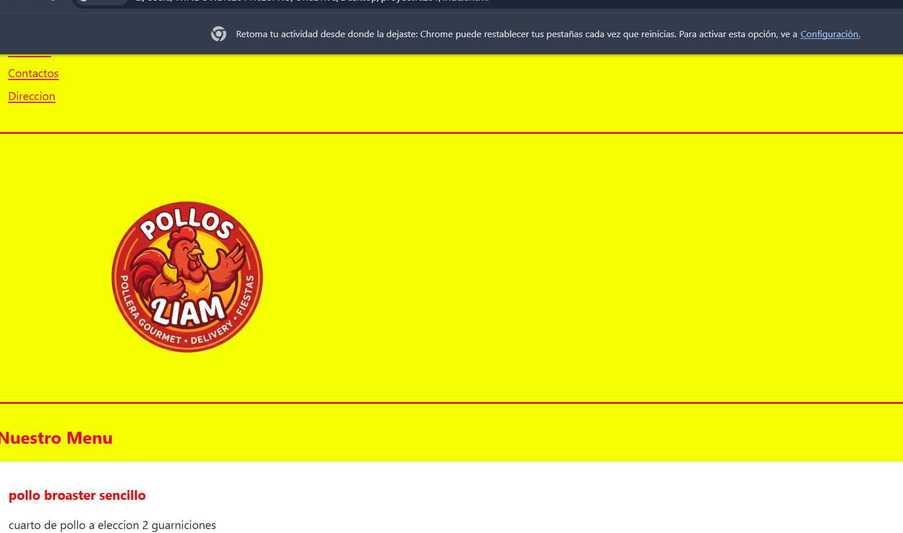

# [Pollos Liam]

**Estudiante:** [Jose Noel Condori Fernandez]

**Cliente:** [Negocio pollos Liam]

**URL publicada:** [DESPUES, PROXIMA SEMANA]

## Qué resuelve
[2-3 frases: 1.el cliente tiene problemas con los pedidios, este sitio ayuda a que los pedidos sean mucho mas faciles de realizar

2.los clientes de pollos Liam no saben el menu que tiene, entonces esta pagina muestra los menus del dia]

## Cómo está construido
- **Semántica:** [1-header: Para el encabezado,o barra de navegación.

2-main: Para el contenido principal.

3-section: Para secciones temáticas (por ejemplo, sección del menú del día, sección de contacto, seccion de horarios y seccion de direccion).

4-article: para el plato que se tiene.

5-aside: para poner una curiosidad sobre pollos Liam.

6-footer: Para mostrar los contactos y direccion.

7-div: se uso para agrupar elementos como texto e imagenes.

8-table: para mostrar el menu ybrelacionarlo cn los precios.]

- **Layout:** [Se utilizó flexbox para alinear los bloques, imagenes para mandarlo a un costado, donde grid me permitio organizar elementos en filas y columnas al mismo tiempo.]
- **Diseño:** [Se utilizo una paleta de colores de rojo y amarillo ya que este es un color que se usa mucho en este tipo de negocios, en la tipografia se uso segoe ui debido a que este es formal y legible. ]

## Capturas

 DESPUES, PROXIMA SEMANA

## Lo más difícil
[El problema que tuve fue con el logo, este al insertarlo tenia un tamaño no adecuado y se reolvio con  un, width="400" height="300"]